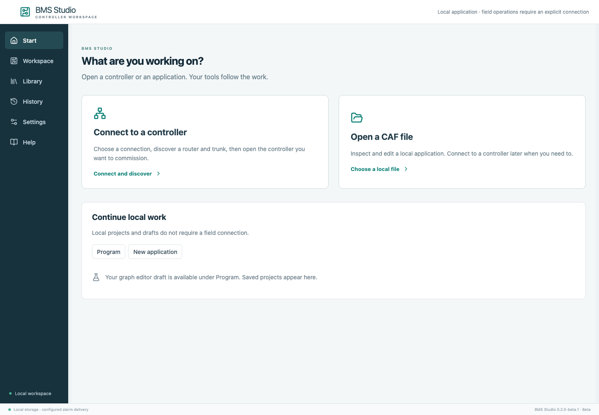
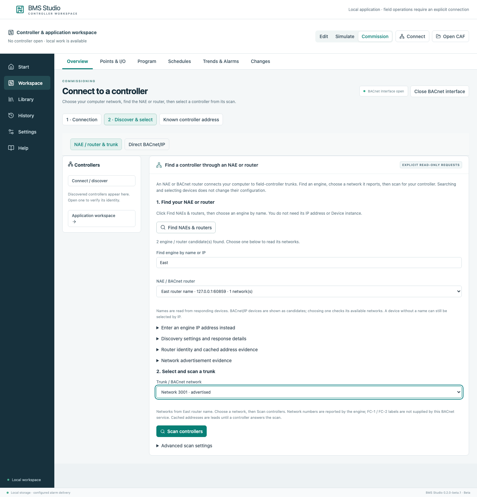
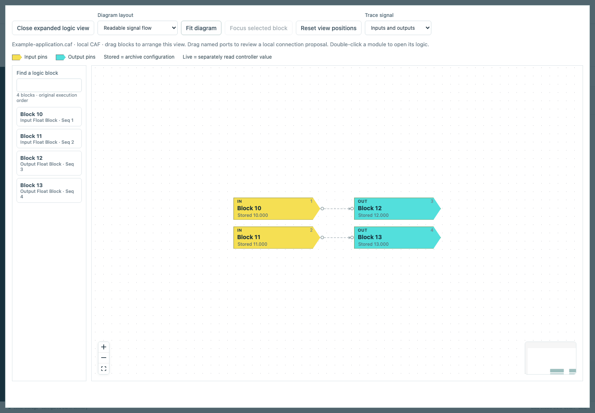

# Getting started with BMS Studio

BMS Studio opens in your browser and runs on your own computer. The desktop
application bundles Python, its runtime dependencies and the web interface.
No Python, Node.js, Terminal or cloud account is needed to use the installer.
This is a beta; use the release's platform and signing table when selecting a download.

## Install, open and quit

| Computer | Download | Install and start |
| --- | --- | --- |
| Apple silicon Mac | `macos-arm64.dmg` | Open the disk image, drag BMS Studio to Applications, then open it. |
| Intel Mac | `macos-x64.dmg` | Use the Intel disk image and the same drag-to-Applications procedure. |
| Windows x64 | `windows-x64-setup.exe` | Run the per-user installer and open BMS Studio from the Start menu. Administrator access is not required. |
| Linux or a managed Python installation | `.whl` | Follow the [Python distribution instructions](portable-distribution.md). This download requires Python. |

Each filename also includes the version. Only platforms listed as verified in the
release notes are qualified for that release. The initial beta may be unsigned or
unnotarized where signing credentials are unavailable. macOS/Gatekeeper or Windows
SmartScreen can therefore display a warning. Check the download's SHA-256 and
release identity before deciding whether to proceed; do not disable OS protections.

The launcher waits for the local editor before opening your default browser.
Launching again opens the verified existing instance for the same user-data
folder. If the usual local port is occupied, the launcher selects an available
port automatically. It never opens an unrelated service merely because that
service uses the usual port.

The small launcher window has **Open editor**, **Open logs** and **Quit BMS
Studio**. Closing a browser tab leaves the editor running. Finish field operations,
release owned commands and disconnect the field interface before quitting. The
launcher refuses normal Quit while the interface or supported writers are active.
It does not silently release a controller override.

## Choose a starting point

Choose **Connect to a controller** for field work, or **Open a CAF file** for local
inspection and supported editing. Opening the app or restoring a draft leaves
field interfaces closed. Local files, saved captures, a simulator and a responding
controller remain distinct data sources.

All screenshots in this guide use isolated, authored example data. The example
addresses are loopback test endpoints, not a real building or a connection preset.

## Connect through an NAE or BACnet router

1. Connect your computer to the authorized building network or its configured VPN.
2. Choose **Connect to a controller**. Select the detected computer network that
   reaches the equipment, then choose **Open interface**.
3. Choose **Find NAEs & routers**. Search by name if several appear, then select
   the intended engine/router.
4. Select a reported network/trunk. Cached address bindings can supply choices
   when a router does not answer network advertisements; they are labelled as
   cached evidence and do not prove a live controller or bus type.
5. Choose **Scan controllers**. Select a controller by its human-readable name
   and complete route, then choose **Open controller** for fresh verification.

An empty response window does not prove that the trunk is empty. Broadcast
discovery may not cross a VPN/router. Use **Enter an engine IP address instead**
for a known reachable engine, or **Known controller address** for a complete known
route. Advanced timing and protocol settings stay under their disclosure controls.
Keep duplicate Device instances distinct by router, network and station address.
See [the controller workspace](controller-workspace.md) for the subsequent tasks.

## Inspect and edit a local CAF

Choose **Open a CAF file**, then **Program → Logic** to inspect the native graph.
Choose **Expand logic view** and **Fit diagram** for the view pictured above.
Use **Objects & parameters** and the operation's contextual controls for supported
local edits. Keep the original file. **Save CAF copy** creates a local artifact;
it does not download a program to a controller. A readable diagram or a successful
local reparse does not establish native compiler or physical acceptance.

## What the beta supports

| Operation | Supported scope and qualification |
| --- | --- |
| Connect, discover and open | BACnet/IP and separately documented serial profiles; selected-route identity verification and discovered objects. Physical adapters and network access remain site-dependent. |
| Points and values | Actual exposed point/configuration reads; supported commands retain ownership, review and readback. No model-based invented inventory. |
| CAF application inspection | Native blocks, wires, parameters and source-bound evidence from supported archive structures; original bytes are retained. |
| CAF editing | Scoped, guarded local copy operations. Unsupported structures remain explicit. A local edit does not imply deployment support. |
| Native identity/settings/I/O edits | Individually qualified existing MCE/tagged-MOI operations with backup, preservation checks, review, single-attempt transfer and readback. See [JCI operation coverage](jci-operation-coverage.md). This is not unrestricted native compilation or allocation. |
| Portable logic and templates | Authored graphs, drag-and-drop editing and deterministic simulation within their documented semantics. Example templates are illustrative, not certified sequences. |
| Native Sedona, Temco and IEC tools | Optional external toolchains and their separately documented profiles; not included in the installers. |
| Vendor software, packages and drivers | CCT/PCT, vendor licenses, controller packages, BTCVT/Bluetooth drivers and manuals are not bundled. This does not remove the app's independently implemented native operations. |

No installer test establishes physical acceptance on every controller, firmware,
I/O module or network. Consult the contextual capability report for the actual
source and operation before preparing a field change.

## Data, logs, updates and removal

| System | Installed application's data folder |
| --- | --- |
| macOS | `~/Library/Application Support/BMS Studio` |
| Windows | `%LOCALAPPDATA%\BMS Studio` |
| Linux | `${XDG_DATA_HOME:-~/.local/share}/bms-studio` |

Use **Open logs** to find `logs/desktop.log`. Logs, controller archives and recovery
journals can contain private field data; keep them local when reporting a bug.
`BMS_STUDIO_DATA` or the launcher's `--data` option selects a different data folder.

To update, finish operations, disconnect and quit, back up the data folder, then
replace the Mac application or run the new Windows installer. The installer does
not migrate the source checkout's `.state` automatically. Do not run old and new
versions concurrently against the same data folder or assume a database downgrade
is supported.

To remove the app, quit it first, then move the Mac app to Trash or use Windows
Installed apps → BMS Studio → Uninstall. Projects, captures, recovery journals and
logs remain in the data folder. Delete that folder only as a separate, deliberate
action after retaining required backups and resolving owned/uncertain operations.

If discovery fails, check the selected network/VPN route and any OS local-network
or firewall prompt. Serial operation needs an OS-supported adapter/driver and
device permissions. The app binds its web server to loopback; no public inbound
web-server rule is required.
