# SCT and JCT feature parity roadmap

Planning baseline: 2026-11-07. **SJ-01 is partial; 47 packages remain planned.** This document
does not declare SCT/JCT interoperability or deployment complete.

Retained native application restore PR #330 was qualified and merged before this
parity work began. Implement this plan one reviewed feature or small coherent
group per PR. This is the next JCI
priority; preserve the existing field-controller and other-manufacturer backlog.
The machine-readable companion is [the parity backlog](sct-jct-parity-backlog.csv).

The [first SJ-01a source/operation inspection](jci-engineering-source-inspection.md)
now works in Help. It provides explicit reader scope and exact local evidence;
exhaustive manual mapping and native SCT/JCT codecs remain unfinished.

## Scope and evidence

SCT means System Configuration Tool. JCT means Johnson Controls System
Configuration Tool, the browser application for archive engineering and Metasys
UI configuration. CCT/PCT field applications, SCT supervisory configuration/LCT
logic, and JCT graphics are distinct artifacts. A BACnet point read or retained
MOI/CAF operation does not establish native supervisory archive support.

The baseline combines the locally retained SCT Help 19.0, its earlier editions,
SCT Pro Help 18.0 and the official JCT 19.0 help. SCT 19.0 adds redundancy-related
configuration; JCT covers archive/device management and graphics engineering.
Versioned sources are listed in [the evidence register](#evidence-register).
Each implementation must resolve its detailed manual sections into executable
acceptance cases. A manual heading or an existing similarly named feature is
not a completed parity check.

The goal is one portable BMS workspace for offline engineering, simulation,
connected configuration, deployment and verification. Preserve native originals
and opaque data while adding explicit codecs and qualified adapters. Support for
our own portable project must remain distinct from importing or exporting an
actual Johnson Controls format. Do not rename a JSON/ZIP project `.dbexport`.

SCT/JCT versions, archive schema, site/server release, engine firmware, field
controller firmware, CCT/PCT packages and graphics versions require separate
compatibility evidence. Start with actual available fixtures, retain legacy
profiles needed by existing FX/Metasys installations, and add release support
without silently upgrading originals.

## Workspace and architecture

Keep **Connect to a controller** and **Open a CAF file** as the primary entry
paths. Open a site archive from **Library → Projects and archives** into the same
application workspace. Site → engine → integration/trunk → controller → point is
an explorer hierarchy, not a new dashboard tile for every function. The existing
teal interface and [workflow style guide](workflow-style-guide.md) remain binding.

| Existing location | SCT/JCT work |
| --- | --- |
| Overview | Site/engine identities, archive provenance, network topology, compatibility and device settings |
| Points & I/O | Supervisory point objects, integrations, source mappings, extensions, bulk attributes and actual values |
| Program | Field programs, supervisory LCT and graphics as clearly distinguished document types |
| Schedules | Weekly/exception/calendar engineering, target links, effective-time preview and deployment |
| Trends & Alarms | Extension configuration, notifications, recipients, dependencies and historical evidence |
| Changes | Comparison, merge conflicts, per-device deployment jobs, verification, reconciliation and recovery |
| Library | Site projects, templates, symbols, equipment definitions and versioned packages |
| History / Settings / Help | Cross-session receipts; credentials/roles/certificates/toolchains; source manuals and capability explanations |

Retain the open controller, exact route/interface, current file and local drafts
when opening archive tools. Every value and graphic binding names its source:
archive, simulator, captured observation or current connected device. A new
archive selection retires incompatible reviews without destroying drafts or
uncertain receipts. Multi-user changes require revision checks and conflict
handling, not last-writer replacement.

```mermaid
flowchart LR
  A[Original archives and captured configuration] --> B[Versioned codecs and provenance]
  B --> C[Typed site and object graph]
  C --> D[Editors, dependency checks and simulation]
  D --> E[Diff, conflict resolution and review]
  E --> F[Qualified per-device adapter and durable job]
  F --> G[Fresh readback and preservation comparison]
  G --> H[Recorded history and explicit recovery]
```

Use a portable versioned project envelope with typed objects, relationships,
resources, original attachments and revision manifests. Keep import/export
codecs separate from live adapters. Supervisory deployment must have its own
native configuration transaction and recovery proof; it must not reuse a
field-controller File3 writer merely because both are called downloads.

## Existing work to preserve and credit

Existing discovery, routed targets, object acquisition, field recording, native
Calendar/Schedule slices, CAF/graph editing and simulation, local source
comparison, field-controller transfers and Changes/History are reusable scopes.
Their remaining gaps stay explicit. In particular:

- [Native retained restore](native-application-restore.md) concerns supported
  field application images; it is not an SCT engine/archive restore.
- [Recorded Changes](change-ledger.md) provides evidence presentation; it is not
  a site-wide atomic configuration transaction or ActionQ implementation.
- [CAF/native source correlation](caf-native-source-correlation.md) provides
  source comparison; it does not establish supervisory schema equivalence.
- Existing graph execution is a foundation for simulation. LCT timing, type,
  state/restart and native compile semantics need their own reference cases.

Do not rebuild these scopes or replace their field-tested interface wholesale.
The 48 packages below are implementation work packages, not 48 newly completed
features or a replacement count for the existing requirement register.

## Coordination with open PRs

Reviewed against GitHub `main` at `80bc5345` on 2026-11-08. The following PRs are
open drafts at that review point. Refresh their status, diff and qualification
before starting overlapping work or integrating them. Their proposed scopes are
reuse candidates; no draft is credited as an implemented capability on `main`.

| PR | Proposed scope to review and reuse | Related parity packages | Remaining boundary |
| --- | --- | --- | --- |
| [#327](https://github.com/JimBoHa/BMS_Programming_Tool/pull/327) | Read-only mapped-point source inspection with native identity and route checks | SJ-03; SCT-03; SCT-04 | Inspection does not edit an existing point source or establish preservation after an edit. |
| [#329](https://github.com/JimBoHa/BMS_Programming_Tool/pull/329) | Exact source manifests and comparison of captured identities, properties and links | SJ-04; SCT-04; SCT-16; SCT-19 | Imported captures are supplemental preservation evidence, not a native backup, fresh readback or authority to apply a change. |
| [#332](https://github.com/JimBoHa/BMS_Programming_Tool/pull/332) | Authenticated configuration client and isolated source-method qualification | SJ-06; SCT-04; SCT-16 | The investigated ordinary source-write methods were refused. This does not qualify production source reassignment or supervisory deployment. |
| [#334](https://github.com/JimBoHa/BMS_Programming_Tool/pull/334) | Separate JCT configuration login and read-only archive/device/object inspection in Settings | SJ-03; SCT-03; SCT-15; JCT-17 | JCT configuration authority is separate from online Metasys authority. Readable archive projections do not qualify native backup, editing or transfer. This PR is stacked on #332. |
| [#335](https://github.com/JimBoHa/BMS_Programming_Tool/pull/335) | Direct NAE native BACnet backup acquisition and native-engine HTTPS authentication/reads | SJ-05; SJ-06; SCT-15; SCT-21 | Internal acquisition and authentication are distinct from native decoding, editing, restore and deployment. Backup File capture and final operator workflows still require their own qualification. |

Integrate one reviewed scope at a time from current `main`. Check branch
dependencies, preserve the running application and port compatible changes
rather than replacing files with older branch versions. Record conflict decisions
and run affected source, installed-build and browser checks as appropriate.
After merging, update the exact scoped criterion, parent-package credit and
inventory evidence without marking the full package complete. Until then, keep
the remaining work and capability counts explicit.

The direct NAE path in #335 and optional JCT archive connection in #334 serve
different sources and authentication realms. A JCT/SCT service must not become a
prerequisite for our portable project or the independently qualified direct NAE
adapter. Reuse existing project revisions, source readers and Changes/History
where their contracts apply. Retain the existing field-controller transfer
profiles; supervisory capture, restore and deployment need their own qualified
transactions and recoverable native originals. SJ-05's durable job requirements
still apply before exposing new supervisory capture or deployment workflows.

## Shared foundations: implement first

| ID | Deliverable and acceptance | Depends on | Placement |
| --- | --- | --- | --- |
| SJ-01 | Build the SCT/JCT parity inventory and fixture manifest. Map manual operations, current code credit, exact release/artifact families, missing samples and evidence levels. Inspect available local archives without publishing site data. Acceptance: every claimed operation links to an actual implementation and reproducible evidence; unknown and unsupported remain distinct. First PR adds useful read-only source/capability inspection, not a blanket support flag. | Active restore delivery | Help; Overview |
| SJ-02 | Implement the portable site-project envelope and local archive staging: source fingerprint, original attachment retention, schema version, duplicate-safe import, revision manifest, copy/export and restart recovery. Add native-container identification with strict content/size/path limits. Acceptance: round-trip authored projects and opaque originals exactly; malformed/encrypted/unknown native sources remain identifiable evidence without invented objects. Native decoding is separately qualified under SCT-02. | SJ-01 | Library; application workspace |
| SJ-03 | Add the typed supervisory object/relationship model. Preserve native IDs, GUIDs, fully qualified references, parents, point-source identities, extensions, links, serving relationships and resource associations. Acceptance: duplicate/ambiguous IDs and unresolved references are visible; no guessed point inventory or renumbering, and an unchanged import/export preserves every represented relationship and original opaque record. | SJ-02 | Overview; Points & I/O; Program |
| SJ-04 | Implement revisions, semantic diffs and three-way conflict handling using original base, archive draft and fresh observation. Distinguish engineering configuration from runtime samples, logs and counters. Acceptance: additions/deletions/moves and all conflicting edits are explicit; chosen resolutions preserve unaffected identities/links and produce deterministic evidence. Unknown coverage blocks a claim of complete preservation. | SJ-03 | Changes |
| SJ-05 | Add a durable per-device engineering job service: queued/authenticating/reviewed/dispatched/verifying/uncertain/completed states, dependencies, pause, cancel-before-dispatch, scheduled work and restart recovery. Acceptance: explicit direction and target, per-device credentials, immutable attempts, no replay after uncertain dispatch, and recoverable partial site progress. UI refresh must never enqueue work. | SJ-03; SJ-04 | Changes; History |
| SJ-06 | Add versioned codec/package provenance and destination resources: brand, engine/site/archive/graphics versions, dependencies, licenses for optional vendor assets and actual reported capacity. Acceptance: capability is operation-specific and source-derived; missing packages/resources are named, unsupported conversions have a loss report, and no model name silently supplies a replacement schema or application. | SJ-01; SJ-03 | Settings; Overview; validation |

## SCT configuration: highest practical utility first

| ID | Planned behavior and acceptance | Dependencies / evidence |
| --- | --- | --- |
| SCT-01 | Archive lifecycle: create, open, close, copy/fork, compare, back up, restore locally, rename and delete a project. Keep independent archives and revisions portable between Macs. Acceptance: local actions need no field connection, never overwrite originals implicitly and preserve draft/resource provenance through restart. Local re-index and database maintenance must operate on the selected project only. | SJ-02; SJ-03. SCT archive/database topics [S1, S2]. |
| SCT-02 | Native SCT archive codecs: qualify actual `.dbexport`, supported native backups, item exports and their relationships to the portable project. Preserve original raw sections and protected attachments; provide an explicit optional extraction bridge when native database decoding needs a compatible external runtime. Acceptance: golden native round-trips, format/version identification and independent SCT import validation for each supported pair. A recognized header alone is not import support. | SJ-02; SJ-03; SJ-06. Native samples/authorized runtime required [S2]. |
| SCT-03 | Site/engine/integration explorer and configuration inspector: discover or import actual hierarchy, names, references, object types, routes, release and resource evidence. Add user views and tailored summaries with search, filters, export and unresolved-object states. Acceptance: duplicate Device IDs on different routes remain distinct, acquisition coverage is explicit and local archive data never substitutes for connected observations. | SJ-03; SJ-06; current discovery. [S1, S4]. |
| SCT-04 | Supervisory object and source editing: create, copy, move, rename, delete and edit supported objects; reassign a point's source while preserving its local identity, GUID, incoming references, trends, alarms, graphics and historian destinations. Acceptance: explicit before/after preservation manifest and dependency checks; partial or unknown link coverage cannot pass complete preservation. First scope is local editing; live application uses SCT-16. | SJ-03; SJ-04; SCT-02. Cross-reference existing inspection/preservation work [S1]. |
| SCT-05 | Attribute/type engineering: units, precision, ranges, enums/state text, relinquish/default values, reliability, naming and display metadata, extended/product-version/validation labels, groups and object-specific settings. Acceptance: type/range/units errors and release-specific read-only fields appear before review; unknown properties retain raw values and provenance instead of being dropped. Wire constraints are reported separately from portable-project limits. | SJ-03; SJ-06; SCT-04. Object/attribute topics [S1]. |
| SCT-06 | Global search and controlled bulk editing: query by object/property/type/route, export a parameter sheet, edit/import changes, rename/substitute references and copy items with children. Acceptance: explicit selection and old-value checks, deterministic dry-run diff, retained duplicate rows, per-object failures and undoable local revision. A bulk review is not an atomic field write. | SJ-03; SJ-04; SCT-05. Search/modify/item topics [S1]. |
| SCT-07 | Integration engineering: represent BACnet/IP, MS/TP, BACnet/SC and supported N2/N1, LonWorks, Modbus, M-Bus, KNX and vendor integrations through independent adapters. Edit trunks, address mappings, polling and exposed integration configuration. Acceptance: actual discovery/capability evidence per adapter; unsupported protocols remain visible without fabricated scans or writes. Reuse qualified routing rather than entering addresses again. | SJ-03; SJ-06; SCT-03. Integration objects [S1]. |
| SCT-08 | Field-point mapping and import: integration-point definitions, point schedules, protocol object/property addresses, mapping diagnostics and duplicate detection. Acceptance: verify the source/destination identifiers and units from real samples, retain unmapped rows and preserve existing engine-local point identities and links. A field Device response does not prove that an NAE mapping points to it correctly. | SCT-04; SCT-05; SCT-07. Field-point topics [S1]. |
| SCT-09 | Extension engineering: alarms, trends, averaging, event/runtime/analog totalization, load and resource-file extensions. Include enablement, thresholds/deadbands/delays, sampling, recipients and storage/reference configuration. Acceptance: independent state/timing cases and full before/after configuration preservation; repository configuration, history retention and data export remain distinct from extension configuration changes. Native deployment requires SCT-16. | SCT-04; SCT-05; SJ-06. Extension topics [S1]. |
| SCT-23 | Rapid engineering: room/point spreadsheet import, controller templates, parameter population, device-to-template matching, bulk spaces/equipment, serving relationships and reusable extensions/resources. Acceptance: per-row validation and explicit substitutions, stable identities, deterministic generated diffs, retained rejected rows and export/import round-trips. CAF templates do not grant new native compilation or package compatibility. | SCT-04; SCT-06; SCT-08; JCT-01; JCT-02. Rapid archive topics [S1]. |
| SCT-24 | Site and engine administration: site director pairing, server/engine names, communication/time settings, operational startup policy and version-qualified redundant-server architecture. Acceptance: topology and identity changes have explicit reconnect/readback plans and recoverable partial outcomes; simulate failover/restart behavior before qualified native activation. Keep certificate/security changes separately reviewed. | SJ-05; SJ-06; SCT-15; SCT-16; SCT-21. Site/engine topics and SCT19 redundancy additions [S1]. |

## SCT testing and validation

| ID | Planned behavior and acceptance | Dependencies / evidence |
| --- | --- | --- |
| SCT-22 | Archive diagnostics and engineering reports: object counts by type/device/class, unresolved references, duplicate IDs, source-binding consistency, package/resource gaps, space/equipment coverage and exportable parameter sheets. Acceptance: every finding links to original evidence, distinguishes absent from unread data, handles partial imports and reproduces the result offline without querying a device. This is the first useful SCT vertical slice after the shared object model. | SJ-03; SJ-06; SCT-03. Archive reports [S4]. |
| SCT-10 | Loss-preserving supervisory LCT reading: program/system blocks, typed pins, constants/enums, references, execution relationships, state and layout. Acceptance: actual native supervisory samples produce a stable graph with source byte references; unknown blocks remain opaque/read-only and do not become guessed CCT blocks. Show incoming/outgoing involvement and error locations. | SJ-03; SJ-06; SCT-02. LCT concepts/workspace [S6]. |
| SCT-11 | Supervisory LCT authoring and native compilation: add/edit/remove supported blocks and links, pin/type/units checks, ordering, constants, timers, math/Boolean/control/selection/statistical/psychrometric primitives and native object allocation. Acceptance: independent native compile/reimport and behavioral fixtures for each supported block/edge/release, exact preservation outside the edit and explicit resource accounting. A drawable diagram does not qualify compilation. | SCT-10; SJ-04; SJ-06. LCT editing/checker [S6]. |
| SCT-12 | LCT simulation and trace: deterministic input playback, quality/reliability, timestep, timers/delays, latches/sequencers, PID/control states, startup/retention, breakpoints and object-reference values. Acceptance: independent expected traces and supported native reference behavior agree on timing, units and restart outcomes; simulator-only nodes are labelled and cannot be deployed as unknown native blocks. | SCT-10; SCT-11; existing simulation. [S6]. |
| SCT-13 | Supervisory schedules and global calendars: weekly patterns, exceptions, date ranges, global references, priority/default values, scheduled objects, time zones/DST and effective-state preview. Acceptance: boundary/DST/holiday/conflict cases, exact native target/property links and round-trip evidence. Reuse existing qualified Calendar/Schedule slices without claiming that their remaining context/evaluation gaps are complete. | SJ-03; SJ-06; SCT-04; existing SCH-01–SCH-03. Schedule topics [S1]. |
| SCT-14 | Supervisory command objects and coordination: interlocks, multiple-command/group objects, broadcasts, load/demand limiting and supported optimization/control policies. Acceptance: simulation proves source/priority/timing/reliability interactions and owned command release; no preview dispatches outputs. Native executable configuration and point-command operations remain separate, explicitly reviewed capabilities. | SCT-05; SCT-09; SCT-11; SCT-12. Supervisory object topics [S1]. |

## SCT deployment and post-deployment verification

Use direction labels consistently: **Transfer from device** captures device
configuration into an archive; **Transfer to device** deploys archive changes.
The JCT Device Manager documentation treats these as server/engine operations,
with field-controller transfers handled separately. Our adapters must retain
that distinction while sharing the operator workflow [J3, J4, S5].

| ID | Planned behavior and acceptance | Dependencies / evidence |
| --- | --- | --- |
| SCT-15 | Engine/server configuration capture: authenticate to the selected device or site director, enumerate available native configuration/resource/security scopes, acquire complete originals with coverage and timestamps, then import into a separate revision. Acceptance: real adapter fixtures prove completeness and cleanup, changed identities/partial reads cannot masquerade as a native backup, and originals survive restart. BACnet object browsing alone is not a full engine upload. | SJ-05; SJ-06; SCT-02; SCT-03. Capture workflow [J3]. |
| SCT-16 | Native supervisory deployment: review a selected configuration delta or complete supported archive against fresh current state, retain a usable native original, validate dependencies/resources and stage/activate one qualified transaction per device. Acceptance: preserve object/GUID/reference/historian identities, verify complete fresh configuration/readback and handle rejection, disconnect, activation/restart and uncertain outcomes without replay. First deployable scope must name the exact native mechanism and release evidence. | SCT-15; SJ-04; SJ-05; SJ-06; appropriate editor/codec. Deployment workflow [J4]. |
| SCT-17 | Trunk utilities and controller workflow integration: browse actual routed trunks, associate CAF/native files, inspect/edit qualified parameters and transfer individual or selected controllers with explicit firmware/package/transport support. Reuse the existing field writer where its profile applies. Acceptance: verify every selected station independently and preserve engine mappings; native MOI capture is never relabelled a reconstructed CAF or whole supervisory archive. Track legacy HVAC PRO, GX-9100, XTM/DX and N2 loader artifact/pass-through families explicitly; qualified optional bridges do not imply native codec parity. BTCVT remains a separate physical qualification. | SCT-07; SCT-08; SCT-15; SJ-05; current JCI field profiles. Trunk utilities [S5]. |
| SCT-18 | ActionQ-equivalent site job orchestration: dependencies, scheduling, progress, per-device authentication, bounded concurrency, stop-on-failure policy, restart-safe checkpoints and result export. Acceptance: mixed success/failed/uncertain jobs remain separately recoverable; pause/cancel never imply an in-flight write was undone. Resuming a queue requires fresh authority where needed and never resends an uncertain operation automatically. | SJ-05; SCT-15; SCT-16; SCT-17. ActionQ [S7]. |
| SCT-19 | Archive/device synchronization with explicit conflicts: compare common base, offline revision and fresh native state; review each conflicting property, object, extension, resource and relationship before staged application. Acceptance: no silent archive-wins rule, omitted field-controller applications remain identified, coverage is complete for the selected scope and post-apply readback matches the chosen resolution. Larger changes can be partitioned visibly rather than silently truncated. | SJ-04; SCT-15; SCT-16; SCT-18. Synchronization [S3]. |
| SCT-20 | Upgrade, migration, firmware image and patch planning: version/package dependency resolution, destination mapping, archive conversion, staged images, network/identity migration and recovery paths. Acceptance: signed/hashed authorized images and golden source/target archive pairs, native restore feasibility, exact per-device readback and explicit unsupported semantics. Preserve originals and export a loss report; firmware/image activation needs its own qualified adapter and hardware acceptance. | SJ-06; SCT-02; SCT-15; SCT-16; SCT-18. Manage Archive/provisioning [S1, S8]. |
| SCT-21 | Security/configuration preservation: inventory and separately manage account/role/security databases, engine/site pairing, certificates, trust chains and protected resource attachments. Acceptance: no implicit password propagation or secret export, authorized protected imports, explicit configuration diffs and recovery, role/expiry failure tests and evidence that unrelated security/historian data survives ordinary program changes. Optional external/vendor tools retain their actual licensing requirements. | SJ-05; SJ-06; SCT-15; SCT-16. Security/certificate topics [S1]; JCT security [J8]. |

## JCT configuration and graphics

These are engineering tools inside the archive/controller workspace. A configured
graphic may display archive or simulator values offline and separately acquired
values when connected. Selecting a preview never connects to a site or grants
point-command authority. Graphics documents and the BMS application's own teal
interface are separate design surfaces.

| ID | Planned behavior and acceptance | Dependencies / evidence |
| --- | --- | --- |
| JCT-01 | Spaces and serving relationships: create/edit/move/copy/delete campus/building/floor/zone/room hierarchies; assign equipment and served-by/serves relationships, import/export tables and search. Acceptance: stable identities, no cycles or silent orphaning, duplicate-safe mass import and preserved relationships across reopen/export. Connected relationships come from the selected source rather than a local sample tree. | SJ-03; SJ-04; SCT-03. Spaces/equipment manager [J5]. |
| JCT-02 | Equipment definitions and equipment instances: typed point roles, display categories, capability/units requirements, reusable definitions, bulk discovery/association and overrides. Acceptance: each binding resolves to a real typed source or an explicit unresolved entry; updates to a definition preserve instance overrides and produce a reviewed impact report. Equipment templates never manufacture controller I/O inventories. | JCT-01; SCT-05; SCT-08; SJ-06. Equipment manager [J5]. |
| JCT-03 | Contextual navigation and archive/source views: building-network and spaces trees, object focus/summary/network/trend views, user-defined views, filters, extension visibility and cross-navigation. Acceptance: exact site/archive/controller/route remains visible, task/surface changes preserve local drafts and stale results cannot return after A→B→A changes. Retain existing responsive navigation and keyboard access. | SCT-03; JCT-01; JCT-02. Navigation [J1]. |
| JCT-04 | Graphics Manager and associations: create, duplicate, version, preview, import/export and delete equipment/space/network/unassigned graphics; manage aliases, exception graphics, master content and legacy associations. Acceptance: association changes are explicit, originals and unresolved resources survive round-trip and preview identifies the selected definition/equipment/source. Native publication depends on a qualified codec/adapter. | SJ-02; SJ-03; SJ-04; JCT-02. Graphics manager [J6]. |
| JCT-05 | Vector graphics editor: shapes, text, lines/paths, images, layout/size/position, grouping, layers, master layer, alignment, snapping, zoom and undo/redo. Acceptance: keyboard and pointer editing, readable desktop/compact layouts, deterministic open-document export and exact native preservation for qualified formats. Use code-native/vector assets and retain unknown native elements instead of flattening editable graphics into a screenshot. | JCT-04; SJ-06. Graphics editing [J6]. |
| JCT-06 | Custom symbols and reusable graphics components: versioned definitions, typed inputs, nested resources, import/export, dependency tracking and symbol libraries. Acceptance: updates have explicit instance-impact diffs; missing assets/fonts and unsupported behaviors are named. Respect provenance of authorized vendor assets; independently authored symbols must work without installing the vendor's runtime. | JCT-05; SJ-06. Symbols and graphics library [J6]. |
| JCT-07 | Equipment/floor-plan templates: independently authored HVAC/plant/terminal equipment, network and floor-plan layouts with reusable point-role bindings and configurable units/styles. Acceptance: template selection creates a local editable draft, unresolved points remain visible and generated graphics have no encoded site inventory or implicit live commands. Source equipment definitions drive binding choices. | JCT-02; JCT-05; JCT-06. Graphics/template topics [J6]. |
| JCT-08 | Binding and alias tools: fully qualified/relative references, network-tree/space/equipment bindings, equipment-definition aliases, exception bindings, point selection and global find/replace. Acceptance: type/units/route checks, explicit zero/one/multiple resolutions, complete impact preview and saved binding provenance. Unknown references are retained; replacing a source preserves the graphic's association and other resources. | SJ-03; SJ-04; SCT-08; JCT-04; JCT-06. Graphics bindings [J9]. |
| JCT-16 | Site Device and engine properties: configure supported site/child devices and exposed focus, communication, network and hardware settings through the common typed editor. Acceptance: observed attributes and actual release capabilities select fields; identity/network changes retain old/new route and reconnect evidence. Do not expose an unrestricted raw-property write as full native configuration support. | SCT-04; SCT-05; SCT-24; SJ-06. Site Device and engine topics [J1]. |
| JCT-17 | Archive administration and collaboration: select/create/upgrade archives, refresh source status, switch projects safely and support multiple editors with revision conflicts. Device Manager reuses the shared capture/deploy/job service. Acceptance: independent drafts and protected credentials, no hidden overwrite between editors, durable activity history and no device action during archive selection or refresh. | SCT-01; SCT-02; SJ-04; SJ-05; SCT-15; SCT-16. Archives/device manager [J1, J3, J4]. |

## JCT testing, simulation and operator verification

First validate typed bindings under JCT-08, then trace their dependencies and
exercise dynamic behavior. These checks precede native graphics publication.

| ID | Planned behavior and acceptance | Dependencies / evidence |
| --- | --- | --- |
| JCT-11 | Involvement and dependency tracing: visualize what influences an object's state and what it affects across logic, mappings, schedules, commands, equipment and graphics. Acceptance: edge types, directions and completeness are source-bound; missing or unexamined native relationships remain unknown. Navigating an edge preserves the original context and never commands the target. | SJ-03; SCT-10; SCT-22; JCT-03. Involvement [J7]. |
| JCT-09 | Graphics behaviors and simulation: typed triggers/rules, visibility, text/units, color, flashing, span/position/rotation, tooltips and qualified command actions. Acceptance: deterministic clocks, values, quality and priority scenarios prove each effect and combined behavior; playback/reload creates no field commands. Connected command controls must use existing ownership/permission/review contracts and retain receipts. | JCT-05; JCT-06; JCT-08; SCT-12. Behavior topics [J10]. |
| JCT-10 | Configurable space/equipment/network dashboards and widgets: summaries, detail, equipment data/relationships/activity, trends, alarms, potential problems and graphic views. Acceptance: offline and simulator preview are useful; connected views use the selected source with quality/timestamp/coverage. Widget navigation retains drafts and readable compact/keyboard layouts without adding global feature tiles. | JCT-01; JCT-02; JCT-03; JCT-04; JCT-08; SCT-09. Widgets [J1, J7]. |
| JCT-12 | Schedule/calendar widgets and effective-time preview: visual weekly/exception/calendar editing, assigned objects, priorities, enablement and time-zone/DST evaluation. Acceptance: shared semantics match SCT-13; offline editing covers supported Calendar exceptions and historical/future evaluation without an arbitrary vendor UI date horizon. Native wire/date ranges remain explicit and qualified deployment uses the selected actual target. | SCT-13; SJ-04; existing schedule UI/contracts. Schedule feature distinctions [J2]. |

## JCT deployment and administration

| ID | Planned behavior and acceptance | Dependencies / evidence |
| --- | --- | --- |
| JCT-18 | Graphics/resource publication and verification: package reviewed associations, aliases, symbols, resources and supported UI/legacy graphics for server or engine-only destinations. Acceptance: native import/publication and fresh readback/rendering prove the selected version and bindings; partial resource transfer, missing associations and unknown formats stay explicit. Transfer receipts remain attached to their original archive/device and permit controlled recovery. | JCT-04; JCT-05; JCT-08; JCT-09; SCT-16; SJ-06. Engine/legacy graphics [J6]. |
| JCT-13 | Alarm/event/group/recipient and remote-notification configuration: destinations, priorities, filters, schedules, acknowledgements and supported email/SNMP/syslog, announcement/banner or other notification profiles. Acceptance: local test sinks prove routing and event/audit distinctions, recipient data stays private, configuration changes retain original evidence, announcement drafts work offline and activation is explicit. Notification tests must not send messages to real recipients without authorization. | SCT-09; SCT-14; SCT-21; SJ-05. Notifications and specialized widgets [J2, J8]. |
| JCT-14 | User/profile/role administration and external identity: project permissions, native user/role configuration where qualified, session policy and version-supported external identity/OAuth integration. Acceptance: permission/expiry/revocation and concurrent-edit cases, explicit distinction between BMS users and device accounts, protected secret storage and preserved audit evidence. MVE-related review/signature workflows require their own validation; no regulatory equivalence is inferred. | SCT-21; SJ-05; SJ-06. User/security topics [J8]. |
| JCT-15 | BACnet/SC and HTTPS certificate management: inventory, chain/expiry/name checks, CSR and certificate import/export, trust configuration, device communication mode and qualified distribution. Acceptance: independently tested invalid/expired/foreign chains, protected private keys, explicit destination review and recoverable partial deployment. Do not disable TLS checking or silently install trust roots to make a connection pass. | SCT-21; SJ-06; qualified SC/TLS adapter. Certificate management [J8]. |

## Vendor limitations to remove deliberately

These are product goals for our implementation. They do not authorize bypassing
device authentication, optional third-party licensing or physical/protocol limits.
Target constraints must be discovered and explained before export or deployment;
they must not silently corrupt or truncate the user's project.

| Documented friction / existing separation | Planned improvement | Evidence and packages |
| --- | --- | --- |
| Native archive/database tooling depends on a vendor runtime and database stack. | Make our primary project portable and useful on macOS; qualify native adapters independently and make an optional extraction bridge explicit. Original encrypted/opaque sections remain retained. | SCT archive/export and installation documentation; SJ-02, SCT-02. |
| Synchronization can prefer the archive on conflicts and does not show where discrepancies exist. | Three-way comparison, visible conflict resolution, scope/coverage report and per-device post-apply verification. Preserve field-program and other omitted scopes explicitly. | [Synchronize][S3]; SJ-04, SCT-19. |
| JCT Device Manager transfer is documented for servers/engines, separately from controllers; selected-device workflows can require common credentials. | One consistent directional workflow with separate qualified supervisory/field adapters and per-device protected credentials. Never pretend one generic writer supports every artifact. | [Transfer from device][J3], [Transfer to device][J4], [Trunk utilities][S5]; SJ-05, SCT-15–SCT-18. |
| JCT offline widgets/graphics show configured point information rather than current values. | Useful archive preview, deterministic simulated values and explicitly acquired connected overlays in the same editor; provenance and command authority remain separate. | [JCT introduction][J1]; JCT-03, JCT-08–JCT-10. |
| Certain discovery, Calendar/summary and Involvement functions are split across JCT, SCT and online UI/platforms. | Expose our supported discovery, local Calendar editing, relationship inspection and dashboards in the same contextual workspace. Availability depends on actual adapter/evidence, not a hidden product-menu boundary. | [JCT features][J2], [object creation][J11]; SCT-03, SCT-13, JCT-10–JCT-12. |
| A documented trailing-character naming case can prevent a folder's deletion in JCT. | Preserve original identifiers, validate proposed target identifiers and provide a qualified native correction/delete path with dependency review. Do not lose the source object or impose that accidental UI limitation on our portable format. | [Creating and deleting objects][J11]; SJ-03, SCT-04. |
| Separate tools, releases and branded packages can hide compatibility and conversion losses. | Explicit source/destination semantics, independently versioned codecs, retained originals and a complete loss report. Our own cross-brand representation should preserve unknown content and allow editing of qualified common semantics. Native export still needs proof for each target. | SCT/JCT package and archive topics; SJ-06, SCT-02, SCT-20. |

## Delivery order after the active feature

The following sequence sets the first small PRs. Later packages are ordered by
their dependencies and user value; a missing native sample must not stop useful
independent local engineering work.

1. **SJ-01:** checked parity/capability inventory and available-fixture discovery.
   Produce a usable read-only inspection result and name unsupported native inputs.
2. **SJ-02a:** a versioned portable site-project manifest, immutable original
   attachments and exact local import/export. No invented SCT conversion claim.
3. **SJ-03a + SCT-03a:** typed site/engine/integration/point identities and a
   source-bound read-only explorer in the existing workspace.
4. **SCT-22a:** object counts, missing/ambiguous references and source-binding
   diagnostics with CSV/JSON evidence. Start with actual supported source kinds.
5. **SJ-04a:** deterministic local configuration comparison and explicit
   preservation/coverage report, followed by conflict-aware local revisions.
6. **SCT-04a/SCT-05a/SCT-06a:** supported local point attributes and source
   proposals with stable identities, old-value checks and useful bulk import.
7. **JCT-01a/JCT-02a:** spaces, equipment definitions and serving relationships;
   then **JCT-04a/JCT-05a/JCT-08a** graphics documents, vector editing and typed
   bindings using those actual objects.
8. In small PRs, qualify native archive codecs/packages, supervisory LCT reading,
   editing and simulation. Add **SJ-05** job primitives before any new native
   supervisory capture/deploy path.
9. **SCT-15 → SCT-16 → SCT-18 → SCT-19:** native capture, one-device deployment,
   durable site jobs and visible synchronization. Field-controller and graphics
   transfers remain independent adapters within that workflow.
10. Expand qualified integrations, rapid engineering, notification/security,
    certificate, graphics publication, migration and redundancy scopes. Preserve
    every remaining parity item and evidence dependency in the backlog.

Suffixes such as `a` indicate the first reviewable slice, not a new package or
completion of its whole parent. Each delivered slice receives its own scoped
criterion and exact acceptance evidence. Update parent credit and remaining work
without rewriting the earlier register as fully implemented.

If a question is necessary, continue all independent work. Follow the user's
15-minute response rule: after that interval, record the unresolved dependency
and move to another independent package. Waiting never supplies missing approval,
credentials, a license or physical acceptance. Current testing remains simulated;
Bluetooth and site writes do not become authorized by this roadmap.

## Acceptance gates and completion definition

| Gate | Required evidence |
| --- | --- |
| Source and preservation | Exact original fingerprints, complete represented object/relationship/resource coverage, duplicate and malformed-input refusal, unknown sections retained and loss reports for unsupported semantics. |
| Local behavior | Deterministic edit/undo/compare/import/export, independent typed/timing reference cases, restart/draft recovery and clear archive/simulator/connected provenance. |
| Native interoperability | Actual authorized source/target samples and vendor/reference import/compile/readback for each claimed archive, LCT, graphics, package and release pair. Format recognition alone never passes. |
| Transfer and recovery | Authored protocol peers exercise success, refusal, partial transfer, loss of acknowledgment, restart and uncertainty; durable original/intent/result records and explicit reconciliation prevent replay. A production native mechanism and recoverable original are required before exposing its Apply action. |
| Browser and distribution | Both controller and local-file/archive entry paths, drafts, target propagation, invalidation, keyboard/compact layouts, offline states, delayed responses and exact evidence downloads in source and actual installed builds. Preserve the existing style guide and required checks. |
| Physical/reference acceptance | Record the actual firmware, topology, engine/server/controller and artifact versions tested. Keep simulator, loopback, vendor-reference and physical results separate; untested physical/BTCVT/MVE scopes remain pending. |

Parity is complete only when the manual-derived operation inventory is mapped,
each claimed operation meets its stated gates and supported version/device pairs
have evidence. All 48 package rows being labelled complete is insufficient if a
manual feature, native format or deployment/recovery scope remains unaccounted
for. Only separately delivered scoped criteria grant runtime credit; this plan grants no additional native capability.

## Evidence register

The source material is versioned reference evidence, not a promise that every
documented operation works on every legacy installation. The local SCT19 PDF is
652 pages, revision 2026-10-13, SHA256
`a8bd468067d46ad3509fdd40c73dcef967a8a7d517b43c5bd4561af45fa794d4`.
Private manuals, native archives, credentials and site inventories remain outside
the public repository. This roadmap paraphrases feature scope and adds our own
implementation/acceptance design; it does not redistribute vendor manuals.

| ID | Primary reference and use |
| --- | --- |
| S1 | [SCT Help 19.0 PDF][S1]: archive/object engineering, extensions, LCT, rapid archive and newer site/redundancy configuration. Earlier SCT releases remain compatibility references. |
| S2 | [Exporting an Archive Database, SCT17.0][S2]: actual `.dbexport` and protected certificate-export behavior. |
| S3 | [Synchronize, SCT17.0][S3]: merge behavior, conflict/coverage limitations and transfer boundaries. |
| S4 | [Archive Reports, SCT17.0][S4]: statistics and unresolved-reference reports. |
| S5 | [Trunk Utilities, SCT17.0][S5]: supervisory pass-through, field-controller files and parameters. |
| S6 | [Logic Connector Tool, SCT19.0 PDF pages 334–366][S6]: supervisory logic model, editor/checker and block behavior. |
| S7 | [ActionQ Overview, SCT17.0][S7]: job lifecycle and operation management. |
| S8 | [Controller Provisioning with Tools 18.0][S8] and locally indexed SCT Pro 18.0 Help, LIT-12013035: separate device/package/transfer workflows. |
| J1 | [JCT introduction 19.0][J1]: archive/graphics purposes, source-value limitations and platform distinctions. |
| J2 | [JCT features 15.0][J2]: schedules, graphics associations, object management, notifications and UI differences. |
| J3 | [Completing a Transfer From Device job 19.0][J3]: engine/server capture, authentication and job options. |
| J4 | [Completing a Transfer To Device job 19.0][J4]: supervisory activation and explicit transfer scope. |
| J5 | [Spaces and Equipment Manager 19.0][J5]: spaces, definitions, equipment and serving relationships. |
| J6 | [Graphics Manager 19.0][J6]: graphics/resources, templates, associations and editor functions. |
| J7 | [Logic Viewer and Editor widget 19.0][J7] and related Involvement/widgets help: supervisory trace/edit and contextual views. |
| J8 | [Security and authorization 19.0][J8]: accounts, network security and protected administrative configuration. |
| J9 | [Working with Bindings 19.0][J9]: graphics references and aliases. |
| J10 | [Custom Behaviors 19.0][J10]: rules, triggers and effects. |
| J11 | [Creating and deleting objects 19.0][J11]: object/discovery distinctions and identifier limitations. |

[S1]: https://docs.johnsoncontrols.com/bas/api/khub/maps/jzVNBtli8gmItAAUTJ4~lw/attachments/nDRklgFXhHrtXxbeqnTi_w-jzVNBtli8gmItAAUTJ4~lw/content
[S2]: https://docs.johnsoncontrols.com/bas/r/Metasys/en-US/SCT-System-Configuration-Tool-Help/17.0/Tools-Menu/Database/Export-Database/Exporting-an-Archive-Database?contentId=NXKX~BN_RhjOFOCT7IvJPg
[S3]: https://docs.johnsoncontrols.com/bas/r/Metasys/en-US/SCT-System-Configuration-Tool-Help/17.0/Tools-Menu/Manage-Archive/Synchronize?contentId=2IB9RFN4NhCniz7WChDwfQ
[S4]: https://docs.johnsoncontrols.com/bas/r/Metasys/en-US/SCT-System-Configuration-Tool-Help/17.0/Tools-Menu/Diagnostics/Archive-Reports?contentId=3D12QCkeGY~iOgGjTmVdjw
[S5]: https://docs.johnsoncontrols.com/bas/r/Metasys/en-US/SCT-System-Configuration-Tool-Help/17.0/Tools-Menu/Trunk-Utilities?contentId=7K7qk5VCQHshmTq4pY5hxA
[S6]: https://docs.johnsoncontrols.com/bas/api/khub/maps/jzVNBtli8gmItAAUTJ4~lw/attachments/nDRklgFXhHrtXxbeqnTi_w-jzVNBtli8gmItAAUTJ4~lw/content#page=334
[S7]: https://docs.johnsoncontrols.com/bas/r/Metasys/en-US/SCT-System-Configuration-Tool-Help/17.0/View-Menu/ActionQ/ActionQ-Overview?contentId=qDQz2sTY0sgcHBIRlpzFgQ
[S8]: https://docs.johnsoncontrols.com/bas/r/Metasys/en-US/Controller-Provisioning-with-Tools/18.0
[J1]: https://docs.johnsoncontrols.com/bas/r/Metasys/en-US/Johnson-Controls-System-Configuration-Tool-JCT-Help/19.0/Overview/JCT-introduction?contentId=s_yougNh8frH~sfjD1sfYA
[J2]: https://docs.johnsoncontrols.com/bas/r/Metasys/en-US/Metasys-UI-and-Johnson-Controls-System-Configuration-Tool-JCT-Technical-Bulletin/15.0/Concepts/JCT/JCT-features
[J3]: https://docs.johnsoncontrols.com/bas/r/Metasys/en-US/Johnson-Controls-System-Configuration-Tool-JCT-Help/19.0/Archives/Device-Manager/Completing-a-Transfer-From-Device-job?contentId=uMCW39KP6tMeMhq_hvMf8w
[J4]: https://docs.johnsoncontrols.com/bas/r/Metasys/en-US/Johnson-Controls-System-Configuration-Tool-JCT-Help/19.0/Archives/Device-Manager/Completing-a-Transfer-To-Device-job?contentId=NhdP5cQKFx9jZHG1F6EdqQ
[J5]: https://docs.johnsoncontrols.com/bas/r/Metasys/en-US/Johnson-Controls-System-Configuration-Tool-JCT-Help/19.0/Navigating-and-searching/Spaces-and-Equipment-Manager?contentId=APLoYqFykBgZHzT2fCUzMg
[J6]: https://docs.johnsoncontrols.com/bas/r/Metasys/en-US/Johnson-Controls-System-Configuration-Tool-JCT-Help/19.0/JCT-Graphics/Graphics-Manager?contentId=2Yf2fpWpIrHdmbBvnhVtUA
[J7]: https://docs.johnsoncontrols.com/bas/r/Metasys/en-US/Johnson-Controls-System-Configuration-Tool-JCT-Help/19.0/Widgets-and-dashboards/Logic-Viewer-and-Editor-widget?contentId=xdAyzOOBz2HZZlc0U4MN2Q
[J8]: https://docs.johnsoncontrols.com/bas/r/Metasys/en-US/Johnson-Controls-System-Configuration-Tool-JCT-Help/19.0/Infrastructure/Security-and-authorization?contentId=qvpBy_fTD2K2porRWzAIxQ
[J9]: https://docs.johnsoncontrols.com/bas/r/Metasys/en-US/Johnson-Controls-System-Configuration-Tool-JCT-Help/19.0/JCT-Graphics/Graphics-Editor/Working-with-Bindings?contentId=W6Zf8FoaZ1gJd_qKaGuBxw
[J10]: https://docs.johnsoncontrols.com/bas/r/Metasys/en-US/Johnson-Controls-System-Configuration-Tool-JCT-Help/19.0/JCT-Graphics/Custom-Behaviors?contentId=NbgsnnWHzFRjO1qESZJtxg
[J11]: https://docs.johnsoncontrols.com/bas/r/Metasys/en-US/Johnson-Controls-System-Configuration-Tool-JCT-Help/19.0/Navigating-and-searching/Creating-and-deleting-objects?contentId=sbFc03zI9Xp9yZIdbAE8gw
